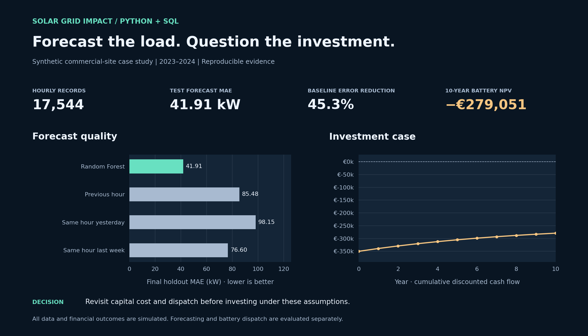
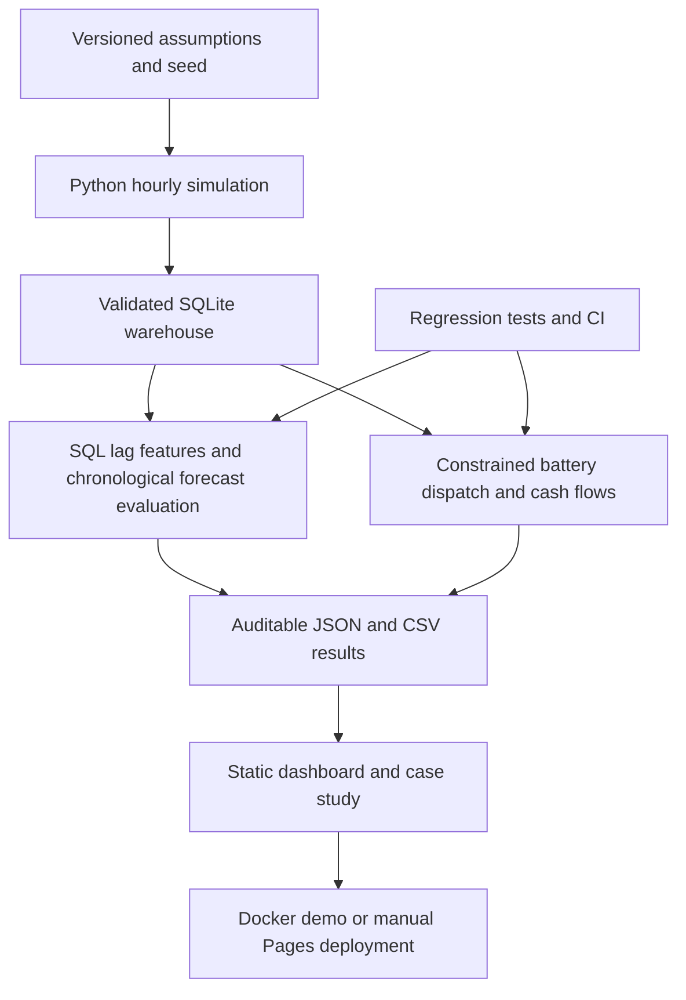

# Solar Grid Impact Analyzer

**Python + SQL energy analytics: from a credible load forecast to a defensible battery investment decision.**

An independent portfolio case study by **Balbir Singh**, combining time-series forecasting, an executed SQL analytics layer, constrained battery dispatch and discounted cash-flow analysis.

**All input data are synthetic. No customer savings, production deployment or verified carbon reduction is claimed.**

[Methodology & assumptions](docs/methodology.md) · [Measured results](reports/metrics.json) · [SQL queries](sql/) · [Case-study notebook](notebooks/01_case_study.ipynb)



Results figure generated from the versioned metrics report. The interactive dashboard is in `docs/` and can be opened with the local server below.

## The decision in 60 seconds

**Should a solar-equipped commercial site add a battery to shift surplus solar into expensive evening hours?**

The base simulation produces positive operating cash flow, but the investment does **not** recover its capital cost within the modeled ten-year horizon. The financial recommendation for this scenario is to defer investment or revisit capital cost, tariffs and dispatch strategy. This is a finding about the stated assumptions, not advice for a real installation.

| Measured output | Result | Interpretation |
|---|---:|---|
| Hourly scenario records | **17,544** | 2023–2024, including leap day |
| Final-test forecast MAE | **41.91 kW** | 4,416 unseen target hours, July–December 2024 |
| MAE improvement over best simple baseline | **45.3%** | Compared with same hour last week |
| Final-test R² | **0.9345** | Synthetic one-hour-ahead evaluation |
| Annualized net battery benefit | **€11,972** | After throughput allowance and fixed OPEX |
| Battery upfront investment | **€350,000** | 1,000 kWh at assumed €350/kWh |
| Ten-year battery NPV | **−€279,051** | 8% discount rate, declining benefits |
| Simple payback | **29.2 years** | Exceeds the ten-year evaluation horizon |

The report also shows **no reduction in the annual import peak** under the evening dispatch rule. Reduced site imports imply 26.83 tonnes of avoided site-import emissions, but crediting the solar exports sacrificed by storage gives **−2.90 tonnes of net avoided emissions**. Storage losses matter; this study does not claim a system-wide carbon saving.

## Business problem and scope

Solar generation, electricity demand and tariffs do not peak at the same time. A battery may reduce the electricity bill while still being a poor investment. A useful analyst must distinguish operating savings, physical feasibility, upfront capital, uncertainty and the strength of the evidence.

This project answers two separate questions:

1. Can an hourly net-load forecast outperform simple historical baselines using only information available at prediction time?
2. Does a transparent solar-storage dispatch rule create enough incremental cash flow to justify battery capital cost?

The work is built around a fictional commercial site, not a utility-scale grid or an E.ON customer. **The forecasting model does not drive the battery policy**; model quality and storage economics are evaluated separately. An ML-driven controller is future work, not an implemented result.

## Architecture



SQLite is part of the actual execution path. Python loads validated observations; SQL computes lagged features, rolling history, monthly KPIs and reconciliation checks. Forecasts and dispatch records are written back into the same warehouse for inspection.

## Forecasting: the evaluation contract

The target is **net load in hour t**. At prediction time, meter readings are available through **t−1**. Features include calendar encodings, lagged load/demand/solar and rolling statistics ending at t−1. Current-hour demand and solar are excluded because their difference directly reveals the target.

| Partition | Period | Usable rows | Purpose |
|---|---|---:|---|
| Training | 2023 | 8,592 | Fit two predeclared candidates after 168-hour warm-up |
| Validation | January–June 2024 | 4,368 | Choose minimum leaf size by MAE |
| Final holdout | July–December 2024 | 4,416 | Report performance after one development-data refit |

Both Random Forest candidates use 64 trees and maximum depth 16; validation selects leaf size 4 over 12. Three expanding-window development checks use a fixed reference configuration. No random train/test split is used.

| Model | Test MAE (kW) | Test RMSE (kW) | Test R² |
|---|---:|---:|---:|
| Random Forest | 41.91 | 57.08 | 0.9345 |
| Previous hour | 85.48 | 111.87 | 0.7483 |
| Same hour yesterday | 98.15 | 142.10 | 0.5938 |
| Same hour last week | 76.60 | 120.21 | 0.7094 |

During the holdout, each newly observed actual becomes available to subsequent hourly forecasts. This is **rolling one-hour forecasting**, not a six-month open-loop forecast. The empirical validation-error band is a diagnostic; it carries no guaranteed future coverage. R² on synthetic data does not establish real-meter accuracy.

## Battery economics and trade-offs

The policy stores surplus PV and discharges into on-site demand from 17:00 to 21:59 UTC. Initial state of charge is zero. The model enforces capacity, power, charge/discharge efficiency and energy conservation. There is no grid charging, battery export or free terminal-energy credit.

The financial comparison uses the complete 2024 scenario: **solar with a battery versus the same solar-equipped site without one**. Operating savings are normalized to a 365.25-day year. Defaults include 1,000 kWh / 500 kW storage, 95% efficiency in each direction, 2% annual fixed OPEX, €0.02/kWh discharged throughput cost, 8% discounting and 2% annual decline in operating benefits.

The 12-combination sensitivity grid varies capacity and capital cost. **Every nonzero-storage combination has negative ten-year NPV under this rule and tariff scenario.** This supports a cautious investment conclusion instead of presenting a positive cash-saving number alone. Taxes, subsidies, debt financing, replacement, demand charges, ancillary revenue and residual value are excluded. These are illustrative assumptions, not current market quotes.

| Choice | Why it fits this project | Trade-off |
|---|---|---|
| SQLite + Python | SQL is inspectable and runs locally without infrastructure | Single-writer, small-data design; not a distributed warehouse |
| Random Forest + three baselines | Nonlinear forecasting with a clear complexity comparison | No extrapolation guarantee; real-site validation still needed |
| Rule-based battery control | Physical and financial behavior is easy to audit | Does not prove globally optimal dispatch or optimal sizing |
| Synthetic scenario | Fully reproducible with no private meter data | Business conclusions do not transfer automatically to real sites |
| Static JSON/SVG dashboard | Portable, no frontend package build or external chart CDN | Batch snapshot, not a live operations system |
| Multi-stage Docker | Analytics dependencies stay out of the serving image | Standard-library server is for a portfolio demo, not hardened production hosting |

Full equations, units, feature availability and assumptions are in [methodology.md](docs/methodology.md).

## Run it locally

Use **Python 3.12**. Commands below start at the repository root.

```bash
git clone https://github.com/Balbir89/Solar-Grid-Impact-Analyzer.git
cd Solar-Grid-Impact-Analyzer
python3.12 -m venv .venv
source .venv/bin/activate
python -m pip install -r requirements-dev.txt -e .
python -m solar_grid build --publish-snapshot
pytest -q
python scripts/verify_report.py
python simple_server.py
```

On Windows, activate with `.venv\Scripts\activate` instead. Open **http://localhost:8000**. Stop the local server with Ctrl+C. To inspect the committed dashboard without rebuilding, only Python and `python simple_server.py` are needed.

The pipeline creates `artifacts/solar.sqlite`, hourly inputs, forecast predictions, dispatch records, monthly KPIs and a metrics report. The `--publish-snapshot` flag refreshes the small versioned evidence files under `reports/` and `docs/`. No API key or paid service is required. The notebook is optional; install JupyterLab separately if you want that interface.

```bash
# Inspect executed SQL directly, if the SQLite CLI is installed
sqlite3 artifacts/solar.sqlite < sql/monthly_kpis.sql

# Build and serve the reproducible container demo
docker build -t solar-grid .
docker run --rm -p 127.0.0.1:8000:8000 solar-grid
```

The Docker build regenerates the dashboard. Its final stage serves only public static files as a non-root user. It does not include the training environment or repository history.

To refresh the README results figure after rebuilding, install the optional presentation dependency with `python -m pip install -e '.[presentation]'`, then run `python scripts/render_summary.py`.

## Repository structure

```text
Solar-Grid-Impact-Analyzer/
├── .github/
│   ├── workflows/ci.yml          # Lint, regression tests, rebuild, Docker smoke test
│   ├── workflows/pages.yml       # Explicit validated deployment from main
│   └── dependabot.yml
├── config/default.json          # Versioned scenario and model assumptions
├── src/solar_grid/
│   ├── config.py                # Configuration validation
│   ├── data.py                  # Seeded simulation and data contracts
│   ├── warehouse.py             # SQLite loading and SQL execution
│   ├── forecast.py              # Time splits, selection, baselines, diagnostics
│   ├── dispatch.py              # Physical constraints and discounted cash flows
│   ├── pipeline.py              # Rebuild and evidence export
│   └── cli.py                   # Command-line entry point
├── sql/                         # Schema, historical features, KPIs, quality checks
├── tests/                       # Leakage, data quality, energy balance, regressions
├── notebooks/01_case_study.ipynb # Thin walkthrough of the tested package
├── docs/                        # Working dashboard, methodology, security, publishing
├── reports/                     # Small, versioned measured outputs
├── scripts/verify_report.py     # Reconcile fresh outputs with published evidence
├── data/reference/              # Preserved original dataset; not used in v2
├── artifacts/                   # Generated locally; excluded from Git
├── Dockerfile
├── requirements.txt             # Pinned runtime environment
├── requirements-dev.txt
├── pyproject.toml
├── simple_server.py
└── README.md
```

## Verification and delivery

The initial rebuild passes **32 automated tests**. They cover future-data contamination, target exclusion, chronological partitions, input gaps/duplicates/nonfinite values, SQL-to-Python reconciliation, SOC and power limits, energy conservation, zero-capacity behavior, carbon export accounting and credential/output hygiene. Test count describes the local check; consult Actions for the status of a particular commit.

CI runs on pull requests and pushes to main/portfolio branches, with read-only repository permissions and pinned action commits. It installs the tested environment, lints code, runs tests, rebuilds analytics, reconciles versioned evidence, uploads audit artifacts and builds/smoke-tests the container. CD is a separate manual GitHub Pages workflow restricted to main. The [publishing guide](docs/repository-details.md) explains its one-time setup. **No live deployment is claimed until that workflow succeeds.**

Data and source hashes in `reports/metrics.json` tie the result to the experiment. Review the report and README when changing assumptions; CI deliberately flags stale evidence. Do not treat identical results from a synthetic generator as external validation.

## Limitations and next steps

Before using this approach for an actual site: obtain licensed meter/PV data; account for meter delays and local time; validate tariffs and marginal emissions; add a forecast-driven optimizer with a causal backtest; and test replacement/degradation and demand-charge assumptions. Monitor data quality and drift after deployment.

The old unseeded notebooks, invalid forecasting inputs, escaped HTML and disconnected SQL example have been replaced. The original CSV and screenshot are retained as explicitly legacy references. The earlier weather credential must still be revoked or rotated by its owner: removing it here does not revoke it or erase Git history. See [credential handling](docs/SECURITY.md).

**Portfolio owner:** [Balbir Singh](https://github.com/Balbir89) · [LinkedIn](https://www.linkedin.com/in/balbir-finance-investment-berlin/)
